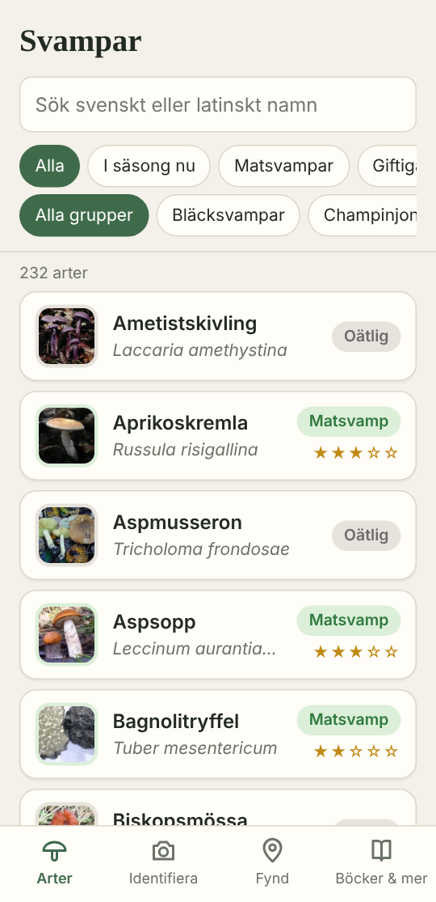
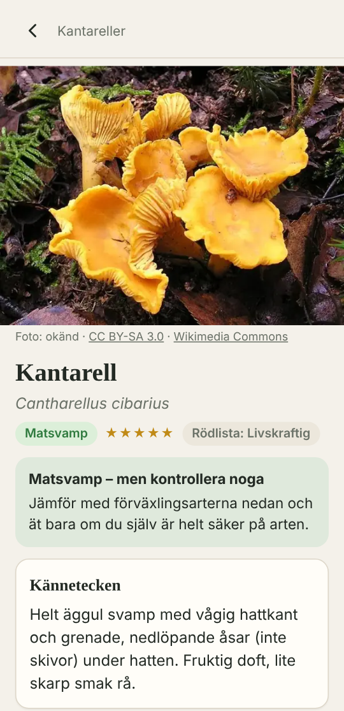
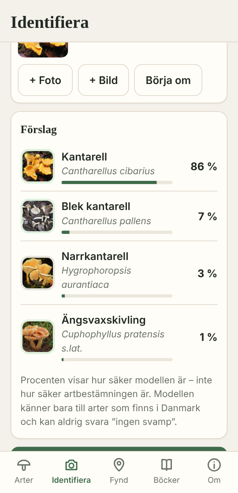
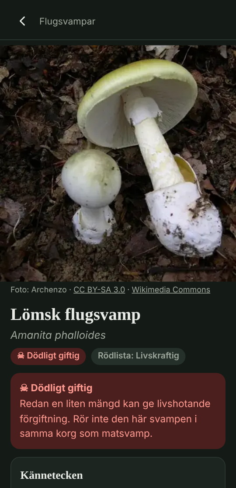

# Lamell (Android)

A field guide to Swedish mushrooms that works fully offline: 250 species with edibility, look-alikes and season, on-device image recognition, and a private log of your finds with GPS positions. The app is in Swedish.

> **Lamell is an aid, not a guarantee.** Image recognition and descriptions can be wrong, and several deadly mushrooms look like edible ones. Never eat a mushroom you have not identified with certainty yourself. Suspected poisoning in Sweden: call 112 and ask for Giftinformation (non-urgent: 010-456 67 00).

  
  
  
  

- **Species (Arter):** 250 Swedish mushrooms, 243 of them with an openly licensed photo – edible, inedible, poisonous and deadly – with key features, habitat, a season calendar, notes, look-alikes (tap to compare), taste rating and red-list status. Search by Swedish or scientific name; filter with two drop-down lists by edibility, group, "in season now" or red-listed. Every species links to its page on Svampguiden and on Artfakta (SLU Artdatabanken).
- **Identify (Identifiera):** take a photo or pick one from the gallery (or share one to Lamell from another app). A neural network running on the phone suggests the most likely species. Add photos of the cap, the underside and the stem base, and Lamell combines them. Deadly and poisonous candidates are flagged, and so are uncertain results.
- **Finds (Fynd):** save where you found mushrooms, with date, GPS position and accuracy, place name, amount, notes and photos. Open a find in your map app, share it, or export all finds as GPX (map apps) or CSV (spreadsheets). Everything stays on the phone.
- **Books (Böcker):** Swedish field guides with links to Libris (the Swedish libraries' joint catalogue), official sources (Giftinformationscentralen, Artfakta, Nationalnyckeln, Artportalen, 1177) and emergency numbers.
- **About (Om):** version, photo and model credits, licence, Support me, and settings (automatic, light or dark theme).
- No account, no ads, no tracking. The only network use is an optional daily check for new versions on GitHub, which you can turn off at first start. Links open in your browser.

## Download

**[Download the latest APK](https://github.com/jonsolberg/lamell/releases/latest/download/Lamell.apk)** · [all releases](https://github.com/jonsolberg/lamell/releases)

To install the APK, allow your browser or file manager to *install unknown apps* when Android asks.

## How it works

The interface is a single page (`app/src/main/assets/index.html`) in a WebView. Native code (`MainActivity.java`) provides the camera, gallery, GPS and file storage. `Classifier.java` runs the image model with [ONNX Runtime](https://onnxruntime.ai/).

The photos are openly licensed photos from Wikimedia Commons (see Credits).

The species facts are in `app/src/main/assets/data/species.json`. The numeric species ids are the Swedish taxon ids (Dyntaxa), so the links to Svampguiden and Artfakta point to the right pages.

The image model is the [Danish Fungi 2020](https://github.com/BohemianVRA/DanishFungiDataset) EfficientNet-B3 classifier ([`BVRA/tf_efficientnet_b3.in1k_ft_df20_384`](https://huggingface.co/BVRA/tf_efficientnet_b3.in1k_ft_df20_384)). It recognises 1,604 species found in Denmark, most of which also grow in Sweden. The model is not kept in this repository. `scripts/build_model.py` downloads it, converts it to ONNX, writes the class labels from the dataset metadata and tests it on photos from Wikimedia Commons, so a wrong label order fails the build. `scripts/check_labels.py` reports which of Lamell's 250 species the model can recognise; older scientific names are matched through `data/synonyms.json`.

## Building

Push to GitHub. The workflow builds the model (cached after the first run) and the APK, and publishes `Lamell.apk` on the `apk` branch and as a release.

To build locally, run `pip install -r scripts/requirements.txt` and `python scripts/build_model.py`, then open the folder in Android Studio and choose *Build → Build APK(s)*. Without the model the app still works, but without image recognition.

Release builds are signed with the key in the repository secrets `SIGNING_KEYSTORE_B64`, `SIGNING_STORE_PASSWORD`, `SIGNING_KEY_ALIAS` and `SIGNING_KEY_PASSWORD`; without them the APK is debug-signed.

## Credits

- Image recognition: Danish Fungi 2020 by Lukáš Picek, Milan Šulc, Jiří Matas et al. (*Danish Fungi 2020 – Not Just Another Image Recognition Dataset*, WACV 2022). The model weights are licensed under [CC BY-NC 4.0](https://creativecommons.org/licenses/by-nc/4.0/) and may not be used commercially. They are not covered by the GPL licence below.
- Photos: [Wikimedia Commons](https://commons.wikimedia.org/) photographers, under CC0, public domain, CC BY or CC BY-SA. The photographer and licence are shown under every photo in the app and listed in `app/src/main/assets/data/photos.json`; `scripts/fetch_photos.py` picks them (the species' image on Wikidata, otherwise its Commons category).
- Taxon ids and red-list categories: [Artfakta](https://artfakta.se/), SLU Artdatabanken.
- [ONNX Runtime](https://github.com/microsoft/onnxruntime) (MIT) and [AndroidX](https://developer.android.com/jetpack/androidx) (Apache 2.0).

## Support

Lamell is free, open source and has no ads. If you find it useful, you can
[support me on Ko-fi](https://ko-fi.com/jonsolberg) ❤️

## License

Copyright © 2026 Jon Solberg

This program is free software: you can redistribute it and/or modify it under the terms of the
GNU General Public License as published by the Free Software Foundation, either version 3 of the
License, or (at your option) any later version.

This program is distributed in the hope that it will be useful, but WITHOUT ANY WARRANTY; without
even the implied warranty of MERCHANTABILITY or FITNESS FOR A PARTICULAR PURPOSE. See the
[GNU General Public License](LICENSE) for more details.
